# PicoDMG

Console portátil de emulação baseado no **Raspberry Pi RP2350**, feito para caber numa
carcaça de Game Boy clássico (DMG) ou em um console próprio. Um **bootloader** residente
lê os emuladores do cartão microSD, grava o escolhido na flash e entrega o controle a
ele. Os 11 emuladores dividem a mesma interface (`shared_menu/`): seletor de ROMs, menu
de pausa, savestates, combos de botões, volume, chave liga/desliga com retomada do jogo
e indicador de bateria.

O projeto nasceu inspirado no [dodger-one/PicoDMG](https://github.com/dodger-one/PicoDMG).
A aparência da interface (`shared_menu/`) tem como referência o
[peterk268/RP2350-GBC](https://github.com/peterk268/RP2350-GBC).

| Tela cheia (`GB_MODE=0`) | Janela da carcaça DMG (`GB_MODE=1`) |
| :---: | :---: |
|  |  |

---

## Sumário

1. [Hardware compatível](#1-hardware-compatível)
2. [Lista de peças](#2-lista-de-peças)
3. [Pinagem](#3-pinagem)
4. [Ligações opcionais](#4-ligações-opcionais-chave-bateria-carregador-rumble)
5. [Diagrama de ligação](#5-diagrama-de-ligação)
6. [Telas](#6-telas)
7. [Emuladores](#7-emuladores)
8. [Cartão microSD](#8-cartão-microsd)
9. [Configuração: `/boot.txt`](#9-configuração-boottxt)
10. [Como usar](#10-como-usar)
11. [Compilar e gravar](#11-compilar-e-gravar)
12. [Como funciona por dentro](#12-como-funciona-por-dentro)
13. [Estrutura do repositório](#13-estrutura-do-repositório)
14. [Licenças e créditos](#14-licenças-e-créditos)

---

## 1. Hardware compatível

O firmware é compilado para duas placas. No código elas se chamam `HW_CONFIG 15` e
`HW_CONFIG 16`. A pinagem principal é a mesma nas duas.

| | **HW15** | **HW16** |
| :--- | :--- | :--- |
| Placa | Waveshare **RP2350 Plus 16 MB** | Waveshare **Core2350B** |
| Microcontrolador | RP2350A (GPIO 0..29) | RP2350B (GPIO 0..47) |
| Flash | 16 MB | 16 MB |
| PSRAM | não tem | **8 MB** (CS em GP47, detectada automaticamente) |
| Display de referência | **ILI9341** 320x240 SPI | **ST7789** 320x240 SPI |
| LED da placa | GP25 | GP39 |
| `PICO_BOARD` | `waveshare_rp2350_plus_16mb` | `waveshare_core2350b` |
| Script de build | `build_for_bootloader.ps1` | `build_core2350b.ps1` |
| Sufixo do UF2 | `PicoNES.uf2` | `PicoNES_hw16.uf2` |

**O que só a HW16 tem**, por causa da PSRAM e dos GPIOs extras:
- jogos de **PC Engine CD** (`.cue` / `.chd`);
- ROMs carregadas na PSRAM em vez de gravadas na flash (NES, SMS/GG, MD, PCE, SNES, NGP
  e WS), o que deixa a troca de jogo mais rápida;
- **indicador de bateria e detecção do carregador**: o RP2350B tem ADC em GP40..GP46,
  enquanto no RP2350A os pinos de ADC (GP26..GP28) estão ocupados pelo áudio;
- pinos acima de GP29 para a chave liga/desliga (ex.: `POWER_PIN=32`).

O painel é escolhido **em tempo de execução** pelo `/boot.txt` (`ST7789=0/1`). Os dois
painéis funcionam nas duas placas; a coluna "Display de referência" é só a combinação
testada.

---

## 2. Lista de peças

Peças usadas na montagem de referência (**HW16**, Waveshare Core2350B em carcaça de Game
Boy DMG). Os custos são em reais, na época da compra, e contam só a fração do pacote usada
em um console (ex.: 1 transistor de um pacote de 100). Os preços mudam; os links são
referências, não as únicas lojas possíveis.

> **HW15:** troque a placa pela Waveshare RP2350 Plus 16 MB e, se quiser, o display por um
> ILI9341 320x240 SPI. Bateria e detecção do carregador só existem na HW16 (seção 1).

### Base

| Foto | Peça | Qtd | Custo (R$) | Link |
| :---: | :--- | :---: | ---: | :--- |
| 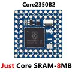 | Waveshare **Core2350B** (16 MB flash, 8 MB PSRAM) | 1 | 75,00 | [AliExpress](https://s.click.aliexpress.com/e/_c3trXfVz) |
| 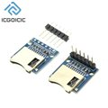 | Módulo microSD SPI (conector dessoldado do módulo) | 1 | 8,00 | [AliExpress](https://s.click.aliexpress.com/e/_c2RFLYjV) |
| 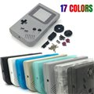 | Carcaça completa de Game Boy DMG (botões e borrachas) | 1 | 57,00 | [AliExpress](https://s.click.aliexpress.com/e/_c3BhMIHD) |
| 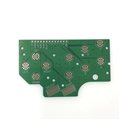 | PCB de botões para Game Boy | 1 | 20,00 | [AliExpress](https://s.click.aliexpress.com/e/_c3zKr3Gj) · [AliExpress](https://s.click.aliexpress.com/e/_c3Knseyn) · [AliExpress](https://pt.aliexpress.com/item/1005013330054567.html) |
| 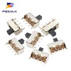 | Chave liga/desliga SPDT **SS-12F44** | 1 | 1,00 | [AliExpress](https://s.click.aliexpress.com/e/_c45qh875) |
| 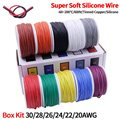 | Fios de silicone 28/30 AWG | 1 | 30,00 | [AliExpress](https://s.click.aliexpress.com/e/_c42nnaaF) |

### Display

| Foto | Peça | Qtd | Custo (R$) | Link |
| :---: | :--- | :---: | ---: | :--- |
| 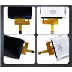 | Display **ST7789V** 320x240 SPI, tela nua (sem placa), FPC 10 pinos | 1 | 28,00 | [AliExpress](https://pt.aliexpress.com/item/1005006335458121.html) |
| 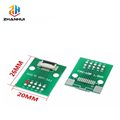 | Adaptador FFC/FPC 0,5 mm 10 pinos | 1 | 13,00 | [AliExpress](https://s.click.aliexpress.com/e/_c3Txa0Lz) |
| 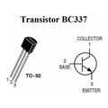 | Transistor **BC337-25** (controle do brilho do backlight) | 1 | 0,12 | [AliExpress](https://s.click.aliexpress.com/e/_c3qzqEQ7) |
| 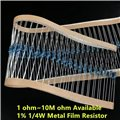 | Resistor 1 kΩ 1/4 W (base do BC337 do backlight) | 1 | 0,12 | [AliExpress](https://s.click.aliexpress.com/e/_c3kkHdyb) |

### Alimentação

| Foto | Peça | Qtd | Custo (R$) | Link |
| :---: | :--- | :---: | ---: | :--- |
| 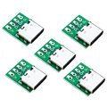 | Conector USB-C fêmea DIP 4 pinos | 1 | 2,00 | [AliExpress](https://s.click.aliexpress.com/e/_c31HaZll) |
| 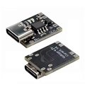 | Carregador **TP4056** com proteção (DW01) | 1 | 7,00 | [AliExpress](https://s.click.aliexpress.com/e/_c4rRAGrH) |
|  | Resistor 100 kΩ 1/4 W (divisor da bateria + detecção do carregador) | 4 | 0,48 | [AliExpress](https://s.click.aliexpress.com/e/_c3kkHdyb) |
| 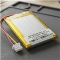 | Bateria Li-ion **103450** 3,7 V (2 ou 3 fios) | 1 | 40,00 | [AliExpress](https://s.click.aliexpress.com/e/_c4q03Fjt) · [Mercado Livre](https://meli.la/1UC4TuF) · [Mercado Livre](https://meli.la/1vGwxQq) |
|  | Kit de conectores JST 2,0 mm (reto) | 1 | 21,00 | [AliExpress](https://s.click.aliexpress.com/e/_c453kUDt) |

### Áudio

| Foto | Peça | Qtd | Custo (R$) | Link |
| :---: | :--- | :---: | ---: | :--- |
| 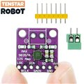 | Amplificador I2S **MAX98357A** | 1 | 6,00 | [AliExpress](https://s.click.aliexpress.com/e/_c4nw1VMb) |
| 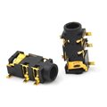 | Conector P2 fêmea (fone) | 1 | 0,65 | [AliExpress](https://s.click.aliexpress.com/e/_c33t8FJD) |
|  | Resistor 100 Ω 1/4 W | 1 | 0,12 | [AliExpress](https://s.click.aliexpress.com/e/_c3kkHdyb) |
| 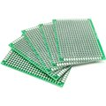 | Placa perfurada para protótipo | 1 | 3,60 | [AliExpress](https://s.click.aliexpress.com/e/_c4Mju4hZ) |
| 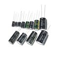 | Capacitor eletrolítico 10 µF | 1 | 0,65 | [AliExpress](https://s.click.aliexpress.com/e/_c4nclSPH) |
| 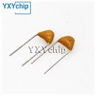 | Capacitor cerâmico 100 nF (104) | 2 | 0,20 | [AliExpress](https://s.click.aliexpress.com/e/_c3rLTHfD) |
| 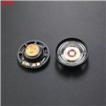 | Alto-falante de Game Boy | 1 | 9,00 | [AliExpress](https://s.click.aliexpress.com/e/_c2zU9N9H) |

### Rumble (opcional, PicoGBC)

| Foto | Peça | Qtd | Custo (R$) | Link |
| :---: | :--- | :---: | ---: | :--- |
| 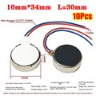 | Motor de vibração **1034** | 1 | 1,80 | [AliExpress](https://s.click.aliexpress.com/e/_c2y2IqLd) · [AliExpress](https://s.click.aliexpress.com/e/_c3UgI5mx) |
|  | Transistor **BC337-25** | 1 | 0,12 | [AliExpress](https://s.click.aliexpress.com/e/_c3qzqEQ7) |
| 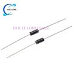 | Diodo **1N4007** | 1 | 0,80 | [AliExpress](https://s.click.aliexpress.com/e/_c2QZA2UJ) |
|  | Resistor 1 kΩ 1/4 W | 1 | 0,12 | [AliExpress](https://s.click.aliexpress.com/e/_c3kkHdyb) |

**Total aproximado por console: R$ 325,78** (com o rumble).

---

## 3. Pinagem

Todos os botões são lidos direto no GPIO, com **pull-up interno** e **nível baixo
ativo**: cada botão liga o GPIO ao GND.

| Função | GPIO | HW15 | HW16 | Observação |
| :--- | :---: | :---: | :---: | :--- |
| **Display** (SPI0) CS | 17 | ✓ | ✓ | |
| Display SCK | 18 | ✓ | ✓ | |
| Display MOSI (SDA) | 19 | ✓ | ✓ | |
| Display DC (RS) | 20 | ✓ | ✓ | |
| Display RST | 21 | ✓ | ✓ | |
| Display backlight (LED/BL) | 22 | ✓ | ✓ | PWM de brilho; na tela nua, via BC337 (ver abaixo) |
| **microSD** (SPI1) MISO | 12 | ✓ | ✓ | |
| microSD CS | 13 | ✓ | ✓ | |
| microSD SCK | 14 | ✓ | ✓ | |
| microSD MOSI | 15 | ✓ | ✓ | |
| **Áudio I2S** DIN | 26 | ✓ | ✓ | MAX98357A, PIO0 |
| Áudio BCLK | 27 | ✓ | ✓ | |
| Áudio LRCLK | 28 | ✓ | ✓ | |
| **UP** | 2 | ✓ | ✓ | |
| **DOWN** | 3 | ✓ | ✓ | |
| **LEFT** | 4 | ✓ | ✓ | |
| **RIGHT** | 5 | ✓ | ✓ | |
| **A** | 6 | ✓ | ✓ | |
| **B** | 7 | ✓ | ✓ | |
| **SELECT** | 8 | ✓ | ✓ | |
| **START** | 9 | ✓ | ✓ | |
| UART0 TX / RX (log de depuração) | 0 / 1 | ✓ | ✓ | 115200 baud |
| PSRAM CS | 47 | — | ✓ | fixo na placa |
| LED da placa | 25 / 39 | 25 | 39 | |
| Chave liga/desliga | `POWER_PIN=` | 10 (padrão) | ex.: 32 | configurável |
| Leitura da bateria (ADC) | `BATT_PIN=` | — | 40 | GP40..GP46 |
| Detecção do carregador | `CHARGE_PIN=` | — | 41 | entrada digital |
| Motor de rumble | `RUMBLE=` | livre | ex.: 23 | GP0..GP9 são recusados |

Os pinos configuráveis (`POWER_PIN=`, `BATT_PIN=`, `CHARGE_PIN=`, `RUMBLE=`) são
opcionais e ficam desligados até a chave correspondente aparecer no `/boot.txt`
(seção 9).

### Display ST7789 de 10 pinos (montagem de referência)

O display da lista de peças é uma tela nua: o FPC vai direto ao adaptador, sem placa, e o
backlight (4 LEDs em paralelo, `LEDA`/`LEDK`) não tem driver. O BC337 liga e desliga o
catodo dos LEDs, e o firmware ajusta o brilho por PWM no GP22.

| Pino do FPC | Sinal | Liga em |
| :---: | :--- | :--- |
| 1 | GND | GND |
| 2 | VCC | 3,3 V |
| 3 | SDA | GP19 |
| 4 | SCK | GP18 |
| 5 | CS | GP17 |
| 6 | RESET | GP21 |
| 7 | LEDA | 3,3 V |
| 8 | LEDK | coletor do BC337 |
| 9 | NC | sem ligação |
| 10 | RS (DC) | GP20 |

```
3,3 V ---------------- LEDA (pino 7)
                       LEDK (pino 8) --- coletor
GP22 --- R 1k -------------------------- base     BC337
                                         emissor --- GND
```

> **HW15:** o GP23 da RP2350 Plus controla o modo da fonte da placa (SMPS). Não use o
> GP23 para rumble nessa placa.

---

## 4. Ligações opcionais (chave, bateria, carregador, rumble)

### Chave liga/desliga (SPDT)

A chave **não corta a alimentação**. Ela só informa o firmware, que salva o jogo e põe o
RP2350 em modo DORMANT (0 a 2 mA medidos, contra ~170 mA jogando).

```
Terminal 1  ---- GND
Terminal 2  ---- GPIO da chave (POWER_PIN)   <- terminal central (comum)
Terminal 3  ---- (sem ligação)
```

Com `POWER_ACTIVE_LOW=1` (padrão): **ON** = GPIO no GND, **OFF** = GPIO em aberto
(puxado para 3,3 V pelo pull-up interno). Na HW15 o padrão é o **GP10**, que fica ao
lado de um pino de GND (pinos físicos 14 e 13).

### Leitura da bateria (HW16)

```
B+ (= OUT+) --- R1 100k 1% ---+--- GP40 (ADC)
                              |       |
                          R2 100k   C 100 nF
                              |       |
OUT- (GND da placa) ----------+-------+
```

- O divisor 1/2 leva 4,2 V para 2,1 V no pino. Consumo permanente de ~21 µA.
- Abaixo de 2,5 V no divisor o firmware entende que **não há célula** (só USB) e esconde o indicador.
- `B-` é só da célula: nada do console liga ali (o MOSFET de proteção fica entre `B-` e `OUT-`).

### Detecção do carregador (HW16)

```
IN+ do TP4056 (5 V do USB)
 |
 R3 (10k..100k)
 |
 +-------- GP41
 |
 R4 (igual ao R3)
 |
OUT- (GND da placa)
```

Com o USB ligado, o GP41 fica em ~2,5 V (nível alto). Não use o pino `CHRG` do TP4056:
com o USB desconectado ele pode ser puxado para 0 V e dar falso "carregando".

### Rumble (PicoGBC, cartuchos MBC5 com vibração)

```
GPIO (RUMBLE=) --- R base (1k) --- base   BC337 (ou 2N2222)
                                   coletor --- motor (-)
                                   emissor --- GND
                     3,3 V ou VSYS --- motor (+)
```

Nunca ligue o motor direto no GPIO. Coloque um diodo (1N4007) em antiparalelo com o motor
para proteger o transistor. Funciona com *Pokémon Pinball*, *Mario Tennis*, *Perfect Dark* e
outros cartuchos dos tipos `0x1C`, `0x1D` e `0x1E`.

---

## 5. Diagrama de ligação

Montagem completa da HW16 (Core2350B): display ST7789 10 pinos, microSD, botões, áudio
MAX98357A com saída P2, bateria com TP4056, chave liga/desliga e rumble.

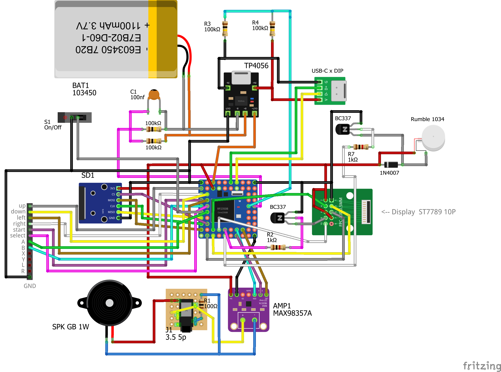

Arquivo editável do Fritzing: [`docs/diagram/PicoDMG_diagrama.fzz`](docs/diagram/PicoDMG_diagrama.fzz).

---

## 6. Telas

### Painéis

| Painel | `ST7789=` | Paisagem (`ROTATE=0`) | 180° (`ROTATE=1`) | Varredura |
| :--- | :---: | :---: | :---: | :--- |
| **ILI9341** | `0` | MADCTL `0x28` | `0xE8` | padrão do painel |
| **ST7789** | `1` | MADCTL `0x60` | `0xA0` | **~111 Hz** (overclock) |

- O ST7789 tem a varredura acelerada de 60 Hz para ~111 Hz. Assim a varredura termina
  antes de o próximo quadro ser escrito, o que elimina o *tearing* em fades e rolagens.
- `INVERT=1` inverte as cores, para painéis que vêm com a inversão ao contrário.
- `MADCTL=0x..` força um valor e tem precedência sobre `ROTATE`. Use só se a imagem sair
  espelhada no seu painel.
- `ST7789_XOFF` / `ST7789_YOFF` corrigem painéis que mostram a imagem deslocada.
- Segurar **SELECT** ao ligar abre o calibrador de painel do bootloader.

### Modo de tela (`GB_MODE`)

| | `GB_MODE=0` (padrão) | `GB_MODE=1` |
| :--- | :--- | :--- |
| Área usada | 320x240, tela cheia | janela **266x240** em **x = 45..310** |
| Bordas | — | pretas: 45 px à esquerda, 9 px à direita |
| Para quê | display solto ou carcaça própria | display dentro da carcaça do Game Boy DMG |

A janela não fica centralizada porque o display não fica centralizado no recorte da
carcaça do DMG (deslocamento de 18 px). Menus, bootloader, overlays e o jogo respeitam a
janela.

### Escala da imagem (menu de pausa → `Image >`)

- **Fit**: maior tamanho que cabe mantendo a proporção.
- **Stretch**: preenche a tela (ou a janela) toda.
- **Integer**: escala inteira centralizada (1x, 2x...). Com `GB_MODE=1`, some do menu
  quando a imagem nativa é mais larga que a janela de 266 px (Mega Drive 320x224, PC
  Engine 320 ou 512 px).
- **Filter**: `Shimmerless` (padrão; suaviza a borda dos pixels em escalas não inteiras
  e evita cintilação na rolagem) ou `Sharp` (vizinho mais próximo). Existe em todos os
  emuladores, menos PicoSNES e Pico8.

---

## 7. Emuladores

| Emulador | Sistema | UF2 | Extensões | ROMs em | Saves em |
| :--- | :--- | :--- | :--- | :--- | :--- |
| `PicoNES` | NES / Famicom Disk System | `PicoNES` | `.nes` `.fds` `.nsf` | `/roms/nes` | `/saves/nes` |
| `PicoSMS` | Master System / SG-1000 | `PicoSMS` | `.sms` `.sg` `.bin` | `/roms/sms` | `/saves/sms` |
| `PicoSMS` | Game Gear | `PicoGG` | `.gg` `.bin` | `/roms/gg` | `/saves/gg` |
| `PicoGBC` | Game Boy Color | `PicoGBC` | `.gb` `.gbc` `.dmg` | `/roms/gbc` | `/saves/gbc` |
| `PicoGBC` | Game Boy (DMG) | `PicoDMG` | `.gb` `.gbc` `.dmg` | `/roms/gb` | `/saves/gb` |
| `PicoMD` | Mega Drive / Genesis | `PicoMD` | `.md` `.bin` `.gen` `.smd` | `/roms/md` | `/saves/md` |
| `PicoPCE` | PC Engine / SuperGrafx | `PicoPCE` | `.pce` `.sgx` (+ `.cue` `.chd` na HW16) | `/roms/pce` | `/saves/pce` |
| `PicoSNES` | Super Nintendo | `PicoSNES` | `.smc` `.sfc` `.fig` `.bin` | `/roms/snes` | `/saves/snes` |
| `PicoNGP` | Neo Geo Pocket / Color | `PicoNGP` | `.ngp` `.ngc` `.ngpc` `.npc` `.bin` | `/roms/ngp` | `/saves/ngp` |
| `PicoWS` | WonderSwan / Color | `PicoWS` | `.ws` `.wsc` | `/roms/ws` | `/saves/ws` |
| `PicoLINX` | Atari Lynx | `PicoLNX` | `.lnx` `.lyx` `.o` `.com` `.bin` | `/roms/lynx` | `/saves/lynx` |
| `PicoA26` | Atari 2600 | `PicoA26` | `.a26` `.bin` `.rom` | `/roms/a26` | `/saves/a26` |
| `Pico8` | PICO-8 (yocto-8) | `Pico8` | `.p8` `.png` | `/roms/p8` | `/saves/p8` |

Destaques:
- **PicoGBC / PicoDMG**: mesmo código, dois UF2. O PicoDMG procura primeiro em
  `/roms/gb` e o PicoGBC em `/roms/gbc`. Jogos de Game Boy clássico ganham a colorização
  automática do GBC, 12 paletas manuais, DMG Green e GB Light (submenu `Palette >` ou
  SELECT + LEFT/RIGHT). Tem **RTC do MBC3** (relógio de Pokémon Gold/Silver/Crystal,
  salvo junto ao `.sav`) e **rumble do MBC5**.
- **PicoPCE**: jogos de CD só na HW16 e só com o **BIOS** no cartão. Ele é procurado
  primeiro na pasta do `.cue`/`.chd` e depois em `/bios/`. Sem BIOS o jogo não abre.
- **PicoSMS / PicoGG**: mesmo código, dois UF2.
- Todo save de bateria (`.sav`/`.srm`) é gravado no cartão, inclusive ao desligar pela chave.

> O repositório **não contém nem distribui ROMs ou BIOS**. Use cópias dos seus
> próprios cartuchos.

---

## 8. Cartão microSD

FAT32. Estrutura:

```
/
├── boot.txt                      configuração (seção 9)
├── emu/
│   ├── 15/                       UF2 da HW15 (PicoNES.uf2, PicoGBC.uf2, ...)
│   ├── 16/                       UF2 da HW16 (renomeie PicoNES_hw16.uf2 -> PicoNES.uf2)
│   ├── emulators.txt             opcional: nomes de exibição
│   └── assets/
│       ├── themes/0..9/          artes do menu gráfico (<NomeDoUF2>.565, 266x240)
│       └── screensaver/
├── roms/
│   ├── nes/  sms/  gg/  gb/  gbc/  md/  pce/  snes/
│   └── ngp/  ws/  lynx/  a26/  p8/
├── saves/                        criado pelos emuladores (.sav, .ss, .cfg)
│   └── <sistema>/
└── bios/                         BIOS do PC Engine CD
```

- O bootloader lista os `.uf2` de `/emu/<HW_CONFIG>` (`/emu/15` ou `/emu/16`). Se a pasta
  não existir ou estiver vazia, usa `/emu`.
- O `emulators.txt` é opcional: sem ele, o nome vem do próprio UF2.
- Artes do menu gráfico: formato `.565` (RGB565 com cabeçalho de largura e altura),
  geradas por `pico-bootLoader/tools/img_to_565.ps1`. As imagens de origem ficam em
  `docs/images/themes/`.

---

## 9. Configuração: `/boot.txt`

Um arquivo de texto na raiz do cartão, com uma `CHAVE=valor` por linha e `#` ou `;` para
comentário. Lido pelo bootloader e por todos os emuladores. O exemplo completo e
comentado está em [`docs/boot.txt.example`](docs/boot.txt.example).

> **Atenção:** o bootloader **recusa o arquivo inteiro** se encontrar uma chave
> desconhecida ou repetida, e mostra `BOOT.TXT INVALID`. Copie os nomes exatamente.

| Chave | Valores | Padrão | Função |
| :--- | :--- | :--- | :--- |
| `GUI` | `0` / `1` | 1 com temas, 0 sem | menu em texto ou gráfico |
| `THEME` | `0`..`9` | `0` | tema de arte do menu gráfico |
| `SCREENSAVER` | `BLOCKS` / `STARFIELD` | `STARFIELD` | protetor de tela do bootloader |
| `BASEDIR` | caminho | `/emu` | pasta dos UF2 |
| `INDEX` | nome de arquivo | `emulators.txt` | índice opcional de nomes |
| `GB_MODE` | `0` / `1` | `0` | tela cheia ou janela DMG |
| `ST7789` | `0` / `1` | `0` (HW15), `1` (HW16) | painel ILI9341 ou ST7789 |
| `ROTATE` | `0` / `1` | `0` | paisagem ou 180° |
| `INVERT` | `0` / `1` | `0` | inversão de cores do painel |
| `MADCTL` | hex (`0x60`) | — | força o MADCTL do painel |
| `ST7789_XOFF` / `ST7789_YOFF` | número | `0` | deslocamento da GRAM |
| `VOLUME` | `0`..`5` | `3` | volume global (0 = mudo) |
| `POWER_SWITCH` | `0` / `1` | `0` | liga a chave liga/desliga |
| `POWER_PIN` | GPIO | `10` | pino da chave |
| `POWER_BEHAVIOR` | `RESUME` / `REBOOT` | `RESUME` | o que fazer ao religar |
| `POWER_ACTIVE_LOW` | `0` / `1` | `1` | 1 = GND é ON |
| `BATT_PIN` | GPIO 40..46 | `0` (desligado) | ADC da bateria (HW16) |
| `CHARGE_PIN` | GPIO | `0` (desligado) | detecção do carregador (HW16) |
| `RUMBLE` | GPIO | `0` (desligado) | motor do rumble (PicoGBC) |
| `RTC_EPOCH` | `AAAA-MM-DD hh:mm:ss` | — | hora inicial do RTC (lida só uma vez) |

O bootloader só regrava `GUI`, `THEME` e `VOLUME`. O resto do arquivo, inclusive os
comentários, fica como você escreveu.

---

## 10. Como usar

### Bootloader

- **D-pad** navega na lista e **A** grava o emulador na flash e o inicia.
- **SELECT** alterna entre lista em texto e carrossel gráfico. No modo gráfico,
  **UP/DOWN** troca o tema.
- O emulador só é regravado quando muda: se ele já está na flash e o UF2 do cartão é o
  mesmo (mesmo CRC), A inicia direto.
- **SELECT + UP/DOWN** muda o volume.

### Seletor de jogos (dentro do emulador)

- **UP/DOWN** move o cursor, **LEFT/RIGHT** troca de página e **A** abre o jogo.
- **SELECT + START** volta ao bootloader.
- Ao sair de um jogo, o cursor volta para o jogo que estava aberto.

### Combos durante o jogo

| Combo | Ação | Disparo |
| :--- | :--- | :--- |
| **SELECT + START** | sai do jogo (grava o save) e volta ao seletor | segurar **~1 s** |
| **START + B** | abre o menu de pausa | ao apertar |
| **START + A** | liga/desliga o contador de FPS | ao apertar |
| **SELECT + A** | velocidade 1x / 2x | ao apertar |
| **SELECT + UP / DOWN** | volume (0..5) | ao apertar |

Quando dois combos coincidem, vale a ordem da tabela, de cima para baixo. Os botões
usados num combo **não chegam ao jogo**: segurar SELECT + START não pausa o Master System
nem faz o Sonic pular.

Combos específicos de alguns emuladores:
- **PicoGBC / PicoDMG**: SELECT + LEFT / RIGHT troca a paleta dos jogos de Game Boy clássico.
- **PicoWS**: soltar SELECT sozinho gira a tela (modo Tate, vertical).

### Menu de pausa (START + B)

| Linha | Ação |
| :--- | :--- |
| **Save State** `1 2 3 4` | escolhe o slot com LEFT/RIGHT e salva com A. Se o slot já tem save, pede confirmação. |
| **Load State** `1 2 3 4` | só os slots com save ficam acesos e selecionáveis. A carrega, depois de confirmar. |
| **Speed** | 1x / 2x |
| **Image >** (`Palette >` no GBC, `Display >` no PCE) | escala, filtro, efeito e opções do sistema |
| **Volume** | Mute, 1..5 |
| **Brightness** | 1..5 |
| **Reset** | reinicia o jogo, mantendo o save de bateria |
| **Exit** | grava o save e volta ao seletor |

**B** fecha o menu. As opções são gravadas em `/saves/<sistema>/<emulador>.cfg` ao abrir
e ao fechar o menu, e voltam na próxima vez que você abrir um jogo.

Ao mudar o volume aparece um indicador na tela por 1 segundo.

### Chave liga/desliga (`POWER_SWITCH=1`)

| Onde você está | OFF | ON (`RESUME`) |
| :--- | :--- | :--- |
| No jogo ou no menu de pausa | salva um savestate de retomada e o save de bateria, depois dorme | logo de abertura e o jogo **volta no mesmo ponto** |
| No seletor de jogos | dorme | volta ao seletor |
| No bootloader | dorme | volta ao bootloader |

- Com `POWER_BEHAVIOR=REBOOT`, ligar de novo reinicia no bootloader.
- O savestate de retomada é um arquivo separado (`<jogo>_R.ss`) e não ocupa os slots 1..4.
- Se a chave for desligada enquanto o bootloader grava a flash, a gravação termina
  antes de o console dormir.

### Bateria (HW16, `BATT_PIN` / `CHARGE_PIN`)

- O seletor e o menu de pausa mostram a porcentagem no canto superior direito.
  Fica **vermelho** em 20 % ou menos e **verde com raio** quando está no carregador.
- No jogo, com 20 % ou menos e sem carregador, aparece um aviso pequeno no canto da tela.
- Em **3,3 V** (medido 3 vezes seguidas, sem carregador), o console salva o jogo como a
  chave faria e dorme. Para voltar, ligue o carregador ou desligue e religue a chave;
  sem carregador, só volta acima de 3,4 V.

### Modo BOOTSEL (gravar o bootloader sem abrir o console)

Segure **SELECT + START + UP** enquanto liga o console. O PC mostra o drive `RPI-RP2`.

---

## 11. Compilar e gravar

### Requisitos

Windows com a extensão **Raspberry Pi Pico** do VS Code, que instala tudo em
`%USERPROFILE%\.pico-sdk`. Os scripts usam esses caminhos:

| Ferramenta | Versão |
| :--- | :--- |
| Pico SDK | 2.3.1 |
| Toolchain Arm GNU | 15.2 Rel1 |
| CMake | 3.28.6 |
| Ninja | 1.12.1 |
| picotool | 2.3.1 |

O PicoPCE da HW16 usa o `libchdr`, que já vem no repositório.

### Compilar

Um emulador:

```powershell
cd PicoNES
.\build_for_bootloader.ps1      # HW15 -> PicoNES.uf2
.\build_core2350b.ps1           # HW16 -> PicoNES_hw16.uf2
```

O bootloader:

```powershell
cd pico-bootLoader
.\build_ili9341.ps1             # HW15 -> build_hw15\pico-bootLoader.uf2
.\build_core2350b.ps1           # HW16 -> build_hw16\pico-bootLoader.uf2
```

Tudo de uma vez:

```powershell
.\tools\build_all.ps1 -Board HW16                 # ou HW15, ou All
.\tools\build_all.ps1 -Board All -Only PicoNES,PicoSMS
```

Se você mudar uma opção de CMake, apague o `CMakeCache.txt` da pasta de build: as
variáveis de placa são de cache e não sobrescrevem um cache existente.

### Gravar

1. **Bootloader** (uma vez): segure o botão BOOT da placa (ou SELECT + START + UP com o
   console já montado) ao ligar no USB e copie o `pico-bootLoader.uf2` para o drive `RPI-RP2`.
2. **Emuladores**: copie os UF2 para `/emu/15/` ou `/emu/16/` no cartão. Na HW16, tire
   o sufixo `_hw16` do nome.
3. Coloque o `/boot.txt` e as ROMs (seção 8) e ligue.

Os UF2 dos emuladores são compilados para o endereço `0x10080000`. Não grave um deles
direto pelo `RPI-RP2`: ele só funciona carregado pelo bootloader.

Binários prontos ficam nos [Releases](../../releases).

---

## 12. Como funciona por dentro

```
Flash (16 MB)
0x10000000  ┌───────────────────────┐
            │ pico-bootLoader 512 KB│  residente, nunca é sobrescrito
0x10080000  ├───────────────────────┤
            │ emulador ativo        │  gravado pelo bootloader a partir do SD
            │ (+ cache de ROM)      │  na HW15 a ROM também vai para a flash
0x11000000  └───────────────────────┘
```

- O bootloader recusa um UF2 com blocos abaixo de `0x10080000` (`WRONG_LINK_ADDR`), para
  não se sobrescrever.
- **Handshake** pelos registradores `watchdog_hw->scratch`, que sobrevivem ao reset:
  `scratch[6] = 0xB007ED01` (iniciado pelo bootloader), `scratch[7] = 0xB007BACE` (voltar
  ao bootloader), `scratch[5] = 0x5E5A6Axx` (acordar do standby e retomar o jogo).
- **`shared_menu/`** é a biblioteca comum: cada emulador entrega um descritor
  (`dmg_emulator_desc_t`) com título, pastas, filtro de ROM e callbacks (save/load state,
  escala, volume...), e ela cuida de toda a interface.
- Vídeo: o Core 0 emula e o Core 1 envia as linhas ao display por SPI + DMA. Os overlays
  (FPS, volume, bateria) são escritos nas linhas antes do envio, sem custo de FPS.

A documentação de projeto completa, com decisões e o histórico de cada correção, está
no [`AGENTS.md`](AGENTS.md) da raiz e no `AGENTS.md` de cada emulador.

---

## 13. Estrutura do repositório

```
PicoDMG/
├── README.md              este arquivo
├── LICENSES.md            licença de cada pasta
├── AGENTS.md              documentação técnica e histórico
├── shared_menu/           interface comum a todos os emuladores
├── pico-bootLoader/       bootloader / lançador
├── PicoNES/ PicoSMS/ PicoGBC/ PicoMD/ PicoPCE/ PicoSNES/
├── PicoNGP/ PicoWS/ PicoLINX/ PicoA26/ Pico8/
├── docs/
│   ├── boot.txt.example   todas as chaves do /boot.txt
│   ├── diagram/           diagrama de ligação (PNG e Fritzing .fzz)
│   ├── core2350b_plan.md  plano da placa HW16
│   └── images/            mockups, logos e artes dos temas
└── tools/
    └── build_all.ps1      compila tudo
```

Cada emulador traz a sua própria cópia de `pico_shared/` (drivers de display, SD e áudio).
As cópias têm alterações diferentes e **não são intercambiáveis**.

---

## 14. Licenças e créditos

Cada pasta mantém a licença do projeto de onde veio. Resumo em
[`LICENSES.md`](LICENSES.md). Dois pontos importantes:

- **PicoSNES** usa o Snes9x, cuja licença **proíbe uso comercial** sem permissão.
- **PicoWS**: o upstream não declara licença.

### Inspiração e referências

- **Inspiração do projeto:** [dodger-one/PicoDMG](https://github.com/dodger-one/PicoDMG),
  o emulador de Game Boy em RP2040/RP2350 com display SPI que deu origem a esta ideia
  (e ao `PicoGBC`).
- **Aparência da interface (`shared_menu/`):** [peterk268/RP2350-GBC](https://github.com/peterk268/RP2350-GBC),
  referência visual do seletor de jogos e do menu de pausa no tema claro.

### Emuladores e bootloader

Baseado no trabalho de:

| Pasta | Upstream |
| :--- | :--- |
| `pico-bootLoader`, `PicoNES`, `PicoSMS`, `PicoMD`, `PicoPCE` | [PicoPlus-devel](https://github.com/PicoPlus-devel) (Frank Hoedemakers e colaboradores) |
| `PicoGBC` | [dodger-one/PicoDMG](https://github.com/dodger-one/PicoDMG) (Peanut-GB) |
| `PicoA26`, `PicoLINX`, `PicoNGP`, `PicoWS` | [xrip](https://github.com/xrip) |
| `PicoSNES` | [libretro/snes9x2002](https://github.com/libretro/snes9x2002) |
| `Pico8` | [yocto-8/yocto-8](https://github.com/yocto-8/yocto-8) |
